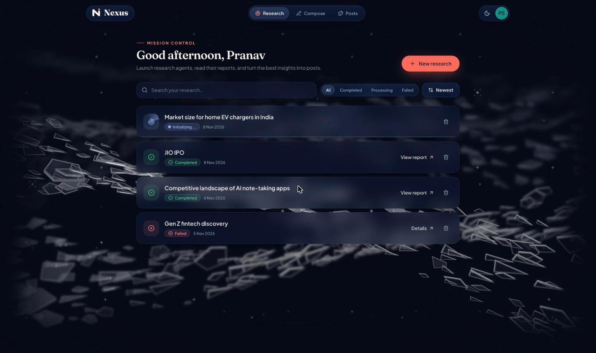
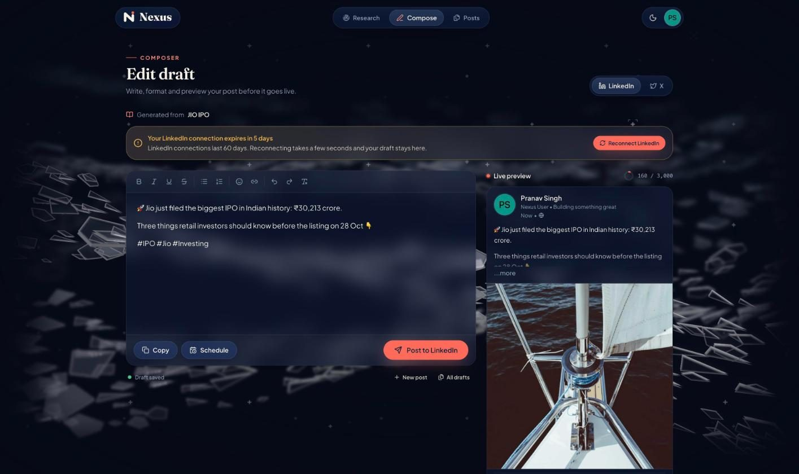
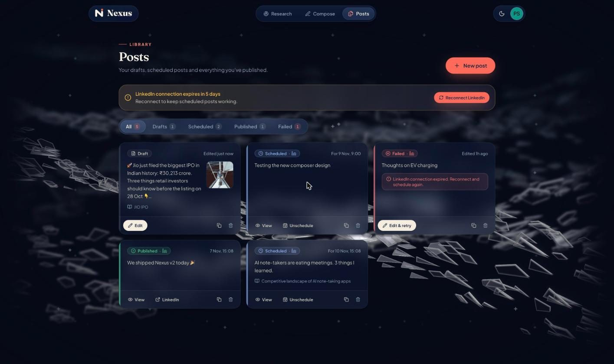
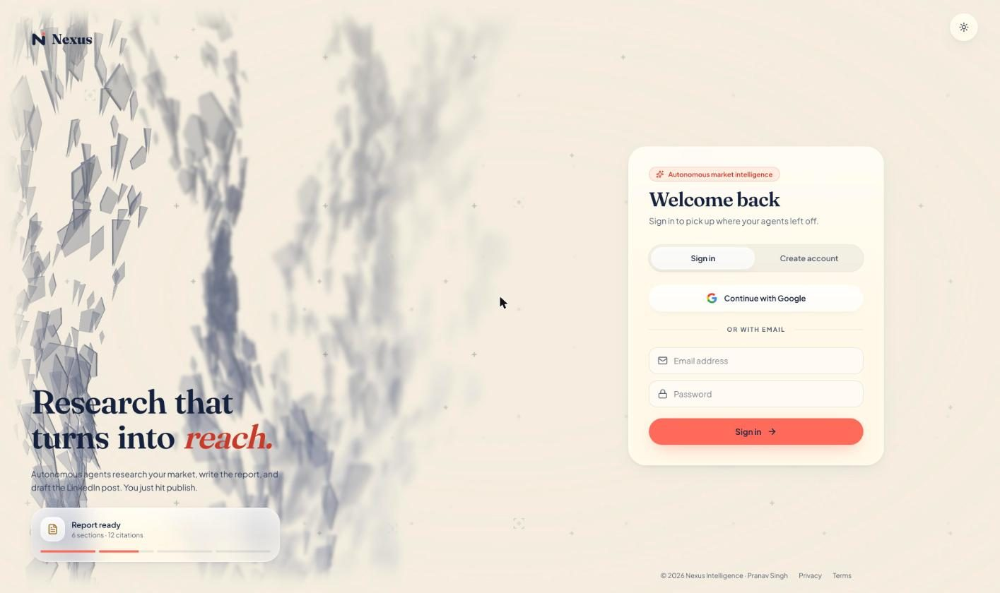
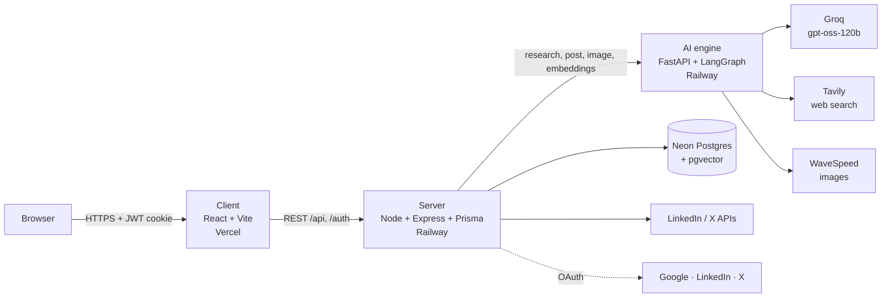

<p align="center">
  <picture>
    <source media="(prefers-color-scheme: dark)" srcset="client/public/brand/nexus-logo-cream.svg">
    
  </picture>
</p>

<p align="center">
  <b>Research that turns into reach.</b><br>
  AI agents research your market, write a cited report, and turn it into a LinkedIn post you can publish or schedule.
</p>

<p align="center">
  <a href="https://nexus-ai-swarm.vercel.app"><b>Live app</b></a> ·
  <a href="https://nexus-project-production-e758.up.railway.app/docs">AI engine API docs</a> ·
  <a href="#run-it-locally">Run it locally</a>
</p>

<p align="center">
  
  
  
  
  
</p>



## What it does

Founders, analysts and marketers spend hours pulling scattered web data into a report, then more time turning it into something worth posting. Nexus does both.

1. **Ask a market question**, like *"Market size for home EV chargers in India"*.
2. **A research agent works on it.** It plans, searches the live web with Tavily, reads the results, and loops until it can answer well.
3. **You get a Markdown report** with tables and linked sources, saved to your account and searchable by meaning, not just keywords.
4. **One click turns the report into a LinkedIn post**: a hook, the key insights, hashtags, and an AI-generated image.
5. **Edit, publish or schedule it.** Drafts save as you type, and every post (draft, scheduled, published or failed) lives on the Posts page.

## Screenshots

| Composer with live LinkedIn preview | Posts library |
| :---: | :---: |
|  |  |

| Sign in (light theme) | |
| :---: | :---: |
|  | |

## Features

**Research**
- A LangGraph agent (reason → search → reason) running on `openai/gpt-oss-120b` through Groq, with Tavily web search.
- Reports render as clean Markdown: headings, tables, and a linked sources list.
- Hybrid search across your research: pgvector similarity (FastEmbed `bge-small-en-v1.5`, 384-dim) combined with keyword matching.
- Analyst notes on every report (add, edit, delete).

**Posts**
- Generate a LinkedIn post from any report, then automatically generate a companion image (WaveSpeed Z-Image Turbo).
- Rich-text composer with a live LinkedIn-style preview, emoji, links, lists, and a character-limit ring.
- Server-saved drafts with autosave, a save-on-leave guard, and duplicate / unschedule / delete.
- Publish now or schedule. A background scheduler posts due items every minute and records success or failure on the draft.
- LinkedIn and X providers behind one interface (`server/src/services/social`).

**Accounts**
- Google sign-in or email + password (bcrypt), with automatic account linking when emails match.
- 30-day sessions in an HTTP-only JWT cookie that renew while you use the app.
- LinkedIn connections last 60 days (LinkedIn's limit for non-partner apps). The app shows days left, warns 7 days ahead, warns when you schedule past the expiry, and reconnects in one click, returning you to where you were.

**Design**
- Navy / cream / coral brand with light and dark themes, plus a circular reveal when you switch.
- iOS-style liquid-glass navigation and frosted surfaces.
- A WebGPU "Aero Shards" background that reacts to the mouse, with a CSS fallback for browsers without WebGPU.
- Page transitions, springy tab indicators, skeleton loaders, and toasts with countdown bars, all respecting the OS "reduce motion" setting.

## Architecture



The browser only ever talks to the Node server. The server owns auth, the database, social posting and the scheduler, and calls the Python AI engine for anything model-related.

## Repository layout

```
nexus-project/
├── client/        React app (Vite, Tailwind v4, framer-motion)  → see client/README.md
├── server/        Express API, Prisma schema + migrations, scheduler → see server/README.md
├── ai-engine/     FastAPI service: research agent, post + image generation, embeddings → see ai-engine/README.md
└── docs/          Screenshots used in this README
```

## Run it locally

**You'll need:** Node.js 20+, Python 3.11+ (3.13 works), Docker (for a local Postgres with pgvector, or use a Neon database), and API keys for Groq, Tavily and WaveSpeed. Google, LinkedIn and X OAuth apps are optional; email sign-up works without them.

**1. Database**

```bash
docker run -d --name nexus-pg -e POSTGRES_PASSWORD=postgres -e POSTGRES_DB=nexus \
  -p 5432:5432 pgvector/pgvector:pg16
```

**2. AI engine** (port 8000)

```bash
cd ai-engine
python3 -m venv venv && source venv/bin/activate
pip install -r requirements.txt
cp .env.example .env          # add GROQ_API_KEY, TAVILY_API_KEY, WAVESPEED_API_KEY
uvicorn app.main:app --reload --port 8000
```

**3. Server** (port 5001)

```bash
cd server
npm install
cp .env.example .env          # DATABASE_URL, COOKIE_KEY, AI_SERVICE_URL=http://localhost:8000 …
npx prisma migrate deploy
npm run dev
```

**4. Client** (port 5173)

```bash
cd client
npm install
cp .env.example .env          # VITE_API_URL=http://localhost:5001
npm run dev
```

Open http://localhost:5173 and create an account.

## Environment variables

Each service has a `.env.example` with every variable listed. In short:

| Service | Required | Optional |
| :--- | :--- | :--- |
| **client** | `VITE_API_URL` | |
| **server** | `DATABASE_URL`, `DIRECT_URL`, `COOKIE_KEY`, `CLIENT_URL`, `SERVER_URL`, `AI_SERVICE_URL` | `GOOGLE_CLIENT_ID/SECRET`, `LINKEDIN_CLIENT_ID/SECRET`, `X_CLIENT_ID/SECRET`, `PORT`, `NODE_ENV` |
| **ai-engine** | `GROQ_API_KEY`, `TAVILY_API_KEY`, `WAVESPEED_API_KEY` | `GROQ_API_KEY_BACKUP` (used on rate limits), `GROQ_MODEL` |

OAuth redirect URLs to register with each provider:

| Provider | Redirect URL |
| :--- | :--- |
| Google | `{SERVER_URL}/auth/google/callback` |
| LinkedIn | `{SERVER_URL}/auth/linkedin/callback` (products: *Sign In with LinkedIn using OpenID Connect* and *Share on LinkedIn*) |
| X | `{SERVER_URL}/auth/x/callback` |

## Deployment

| Part | Host | Notes |
| :--- | :--- | :--- |
| Client | Vercel | Root `client/`. `vercel.json` rewrites every path to the SPA. Set `VITE_API_URL`. |
| Server | Railway | Root `server/`. `npm install` runs `prisma generate`. Run `npx prisma migrate deploy` on schema changes. |
| AI engine | Railway | Root `ai-engine/`. Started by the `Procfile` (`uvicorn app.main:app`). |
| Database | Neon | Enable the `vector` extension. Use the pooled URL for `DATABASE_URL` and the direct URL for `DIRECT_URL`. |

In production the session cookie is `Secure` and `SameSite=None`, so the client and server must both be on HTTPS, and `CLIENT_URL` must exactly match the Vercel origin (CORS).

## Brand

The logo files live in [`client/public/brand`](client/public/brand): the mark and the full logo for light and dark backgrounds, the app icon, PNG icons, and the link-preview image.

| | Hex | Use |
| :--- | :--- | :--- |
| Navy | `#14213D` | Primary: text, buttons, light-theme ink |
| Cream | `#F4EDE0` | Secondary: backgrounds, dark-theme ink |
| Coral | `#FF6B5B` | Accent: calls to action, the dot in the mark |

Type: **Fraunces** (headings, wordmark) and **Plus Jakarta Sans** (UI).

## Credits

- Background: [Aero Shards](https://reactbits.dev/c/backgrounds/aero-shards) from React Bits by David Haz (MIT + Commons Clause), built on [vgpu](https://github.com/vercel-labs/vgpu).
- Fonts: [Fraunces](https://fonts.google.com/specimen/Fraunces) and [Plus Jakarta Sans](https://fonts.google.com/specimen/Plus+Jakarta+Sans) (SIL Open Font License).
- Icons: [Lucide](https://lucide.dev).

---

Built by [Pranav Singh](https://github.com/Pranav-Singh-Devloper).
